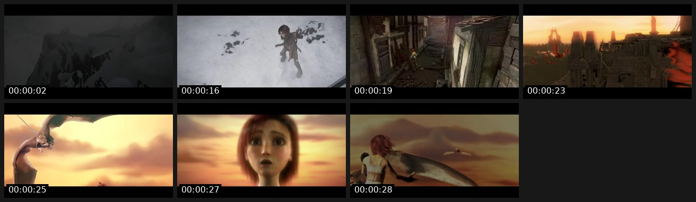

title: Extract frames from video by API - scene detection, blank-frame skipping and a free contact sheet
description: Turn MP4, MOV, WebM, MKV or AVI files into still images in one API call - evenly spaced, every N seconds, at exact timestamps, at scene changes or at keyframes. Real runs, the output with timecodes, and how blank frames and long shots are handled.
date: 2026-11-27
lang: en
slug: extract-frames-from-video-api
pair: kadry-z-video-api
---
Thumbnails for a video catalogue, screenshots for a report, stills for an AI vision model, a quick look at what is in
a 3-hour recording - all of these need the same step: get the right frames out of a video as images. This post
shows a tool that does it in one call, with five ways to choose the frames. Every output below is from real runs on
26 November 2026.

> Disclosure: I built the tool, [Video Frame Extractor](https://apify.com/ai_admin/video-frame-extractor) on Apify.
> The code is open: [AndriyVK/-apify-document-tools](https://github.com/AndriyVK/-apify-document-tools).

## One call

```python
from apify_client import ApifyClient

client = ApifyClient("<YOUR_APIFY_TOKEN>")
run = client.actor("ai_admin/video-frame-extractor").call(run_input={
    "sources": [{"url": "https://api.apify.com/v2/key-value-stores/FloomuI2DrQCJazY8/records/sintel-trailer-480p.mp4"}],
    "mode": "scenes",
    "skipBlankFrames": True,
    "contactSheet": True,
})
for item in client.dataset(run["defaultDatasetId"]).iterate_items():
    for frame in item["frames"]:
        print(frame["timecode"], frame["url"])
    print(item["contactSheetUrl"])
```

## What came back

The video is the trailer of the open movie Sintel (52 seconds, 854 x 480). In scene mode the tool found 7 scenes and
returned one frame for each, with its timecode, a link to the image and a contact sheet of all of them:



*Sintel, (c) Blender Foundation, durian.blender.org, CC BY 3.0.*

Each record also carries the video details: length, size, frame rate and codec. One frame from the output:

```json
{
  "index": 2,
  "time": 16.5,
  "timecode": "00:00:16.500",
  "key": "0001-sintel-trailer-480p-00002.jpg",
  "url": "https://api.apify.com/v2/key-value-stores/.../records/0001-sintel-trailer-480p-00002.jpg"
}
```

The scene changes match the reference: ffmpeg's own scene filter at the same threshold finds the cuts at the same
moments.

## Five ways to choose frames

| Mode | What you get | Good for |
|---|---|---|
| `count` | N frames spread evenly over the video | a preview, a thumbnail grid |
| `interval` | a frame every N seconds | long recordings, monitoring |
| `timestamps` | frames at the exact times you give | screenshots of known moments |
| `scenes` | one frame per scene change | a storyboard, input for AI vision |
| `keyframes` | the video's own keyframes | fast extraction from long files |

Any mode can be limited to a part of the video with `startTime` and `endTime`. In a run on a 3-minute 1080p video,
`interval` every 10 seconds between 00:30 and 01:30 returned exactly 7 frames, at 30, 40, ... 90 seconds.

## The details that save you time

- **Blank frames are skipped, and the scene is kept.** Fade-ins, black inserts and flat-colour frames are not useful
  as thumbnails or for AI. With `skipBlankFrames` the tool takes a frame a moment later in the same scene instead.
  On the Sintel trailer that turned three black frames into real pictures (at 2, 19.5 and 28.7 seconds), and a test
  video that fades in from black gives its first frame at 0.7 seconds instead of losing the scene. The check is free.
- **Long shots get a clear hint.** An interview, a lecture or a screen recording has no hard cuts. In scene mode such
  a video still returns its frame, with a note to lower `sceneThreshold` or switch to `interval`.
- **Contact sheet for free.** One image with all frames and their timecodes, to check a video at a glance.
- **Formats.** MP4, MOV, WebM, MKV and AVI in; JPG, PNG or WebP out, with an optional maximum width.
- **Clear errors, no charge.** If a link fails or every frame in a video is blank, you get an error that says why,
  and that video is not charged.

## Price

You pay per saved frame: $0.002 on paid plans, $0.0025 on the free plan, plus $0.001 per started minute of video
analysed in scene mode. The contact sheet and the blank-frame check are free. A fair price, with no hidden extras:
the 7 scene frames of the Sintel trailer above cost $0.015.

## Ideas

- **Thumbnails and previews** for a video library, a course or a marketplace.
- **Frames for AI vision**: describe a video, find products or text in it, check content - send the scene frames to a
  vision model instead of the whole file. The tool is also an MCP tool for Claude, Cursor and other agents - see
  [MCP server for document and media tools](/mcp-document-tools-for-ai-agents/).
- **Storyboards** of ads and trailers, one frame per scene.
- **Reports**: screenshots of exact moments of a recording, with timecodes.

What would you extract frames for first? Tell me in the comments.

## Try it in two minutes

1. Open [Video Frame Extractor](https://apify.com/ai_admin/video-frame-extractor) and press **Try for free**.
2. The input is already filled with a working example: press **Start**, or put in links to your own videos.
3. Apify's free plan includes $5 of usage every month - enough to test it on your own data.
