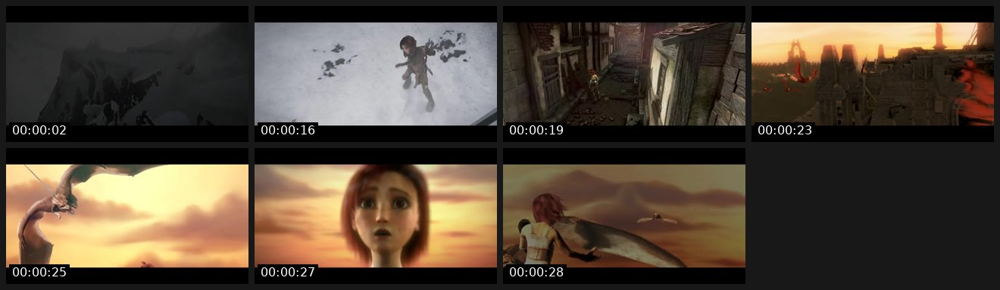

title: Кадри з відео через API - пошук сцен, пропуск порожніх кадрів і безкоштовний аркуш перегляду
description: Як одним викликом API перетворити MP4, MOV, WebM, MKV чи AVI на зображення - рівномірно, кожні N секунд, у точні моменти, на зміні сцен або на ключових кадрах. Справжні запуски, результат із таймкодами і як обробляються порожні кадри та довгі плани.
date: 2026-11-27
lang: uk
slug: kadry-z-video-api
pair: extract-frames-from-video-api
---
Обкладинки для каталогу відео, знімки екрана для звіту, кадри для ШІ-моделі, що бачить зображення, швидкий погляд на
те, що є в 3-годинному записі, - усе це потребує одного кроку: дістати з відео потрібні кадри як зображення. Тут -
інструмент, що робить це одним викликом і має п'ять способів вибрати кадри. Усі результати нижче - зі справжніх
запусків 26 листопада 2026 року.

> Розкриття: інструмент зробив я, [Video Frame Extractor](https://apify.com/ai_admin/video-frame-extractor) на Apify.
> Код відкритий: [AndriyVK/-apify-document-tools](https://github.com/AndriyVK/-apify-document-tools).

## Один виклик

```python
from apify_client import ApifyClient

client = ApifyClient("<ВАШ_ТОКЕН_APIFY>")
run = client.actor("ai_admin/video-frame-extractor").call(run_input={
    "sources": [{"url": "https://api.apify.com/v2/key-value-stores/FloomuI2DrQCJazY8/records/sintel-trailer-480p.mp4"}],
    "mode": "scenes",
    "skipBlankFrames": True,
    "contactSheet": True,
})
for item in client.dataset(run["defaultDatasetId"]).iterate_items():
    for frame in item["frames"]:
        print(frame["timecode"], frame["url"])
    print(item["contactSheetUrl"])
```

## Що повернулося

Відео - трейлер відкритого фільму Sintel (52 секунди, 854 x 480). У режимі сцен інструмент знайшов 7 сцен і повернув
по кадру на кожну, з таймкодом, посиланням на зображення і аркушем перегляду з усіма кадрами:



*Sintel, (c) Blender Foundation, durian.blender.org, CC BY 3.0.*

Кожен запис містить і дані відео: тривалість, розмір, частоту кадрів і кодек. Один кадр із результату:

```json
{
  "index": 2,
  "time": 16.5,
  "timecode": "00:00:16.500",
  "key": "0001-sintel-trailer-480p-00002.jpg",
  "url": "https://api.apify.com/v2/key-value-stores/.../records/0001-sintel-trailer-480p-00002.jpg"
}
```

Зміни сцен збігаються з еталоном: власний фільтр сцен ffmpeg з тим самим порогом знаходить склейки в ті самі моменти.

## П'ять способів вибрати кадри

| Режим | Що ви отримуєте | Для чого |
|---|---|---|
| `count` | N кадрів, рівномірно по всьому відео | попередній перегляд, сітка обкладинок |
| `interval` | кадр кожні N секунд | довгі записи, моніторинг |
| `timestamps` | кадри в точні моменти, які ви задаєте | знімки відомих моментів |
| `scenes` | кадр на кожну зміну сцени | розкадровка, дані для ШІ |
| `keyframes` | власні ключові кадри відео | швидке видобування з довгих файлів |

Будь-який режим можна обмежити частиною відео через `startTime` і `endTime`. У запуску на 3-хвилинному відео 1080p
режим `interval` кожні 10 секунд між 00:30 і 01:30 повернув рівно 7 кадрів: на 30, 40, ... 90 секунді.

## Деталі, що заощаджують час

- **Порожні кадри пропускаються, а сцена лишається.** Появи із затемнення, чорні вставки й кадри одного кольору не
  годяться ні як обкладинка, ні для ШІ. З `skipBlankFrames` інструмент бере кадр трохи пізніше в тій самій сцені.
  На трейлері Sintel так три чорні кадри стали справжніми зображеннями (на 2, 19,5 і 28,7 секунді), а тестове відео,
  що з'являється із затемнення, дає перший кадр на 0,7 секунді замість того, щоб втратити сцену. Перевірка
  безкоштовна.
- **Довгі плани отримують зрозумілу підказку.** В інтерв'ю, лекції чи записі екрана немає різких склейок. У режимі
  сцен таке відео все одно повертає кадр, із приміткою знизити `sceneThreshold` або перейти на `interval`.
- **Аркуш перегляду безкоштовно.** Одне зображення з усіма кадрами й таймкодами, щоб оцінити відео з першого погляду.
- **Формати.** На вході MP4, MOV, WebM, MKV і AVI; на виході JPG, PNG або WebP, за бажанням з обмеженням ширини.
- **Зрозумілі помилки без оплати.** Якщо посилання не працює або всі кадри відео порожні, ви отримаєте помилку з
  поясненням, і це відео не оплачується.

## Ціна

Оплата за кожен збережений кадр: $0,002 на платних планах, $0,0025 на безкоштовному, плюс $0,001 за кожну розпочату
хвилину відео, проаналізовану в режимі сцен. Аркуш перегляду і перевірка порожніх кадрів безкоштовні. Справедлива
ціна, без прихованих доплат: 7 кадрів сцен трейлера Sintel вище коштували $0,015.

## Ідеї

- **Обкладинки й попередній перегляд** для відеотеки, курсу чи маркетплейсу.
- **Кадри для ШІ**: описати відео, знайти в ньому товари чи текст, перевірити вміст - надішліть моделі кадри сцен
  замість усього файлу. Інструмент є й інструментом MCP для Claude, Cursor та інших агентів - див.
  [MCP-сервер для ШІ-агентів](/uk/mcp-instrumenty-dlia-shi-ahentiv/).
- **Розкадровки** реклами й трейлерів, по кадру на сцену.
- **Звіти**: знімки точних моментів запису з таймкодами.

Для чого ви видобували б кадри першими? Напишіть у коментарях.

## Спробувати за дві хвилини

1. Відкрийте [Video Frame Extractor](https://apify.com/ai_admin/video-frame-extractor) і натисніть **Try for free**.
2. Поле вводу вже заповнене робочим прикладом: натисніть **Start** або вставте посилання на власні відео.
3. Безкоштовний план Apify щомісяця дає $5 на використання - цього досить, щоб перевірити інструмент на своїх даних.
